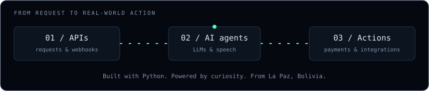

<div align="center">


<a href="https://github.com/DenverCoder1/readme-typing-svg">
  
</a>

</div>

```text
$ cat about.txt
```

I build the backend side of things: APIs, webhooks, payments and the glue between systems that were never meant to talk.
Lately most of my time goes into LLM agents and speech-to-text pipelines that have to work in production, not just in a demo.
Systems engineer from EMI, freelancing from La Paz. You'll usually find me around GDG La Paz or at a hackathon.

<p align="center">
  
</p>

<p>
  <a href="https://dilancimarchn.github.io"></a>
  <a href="https://www.linkedin.com/in/dilan-cimar-choque-nina-developer"></a>
  <a href="mailto:dilancimarchn@gmail.com"></a>
</p>

```text
$ cat stack.conf
```

<a href="https://skillicons.dev">
  
</a>

```text
$ git log --stat --author=dilanCimarChn
```

<p align="center">
  
  
</p>

<picture>
  <source media="(prefers-color-scheme: dark)" srcset="https://raw.githubusercontent.com/dilanCimarChn/dilanCimarChn/output/snake-dark.svg">
  <source media="(prefers-color-scheme: light)" srcset="https://raw.githubusercontent.com/dilanCimarChn/dilanCimarChn/output/snake.svg">
  
</picture>
